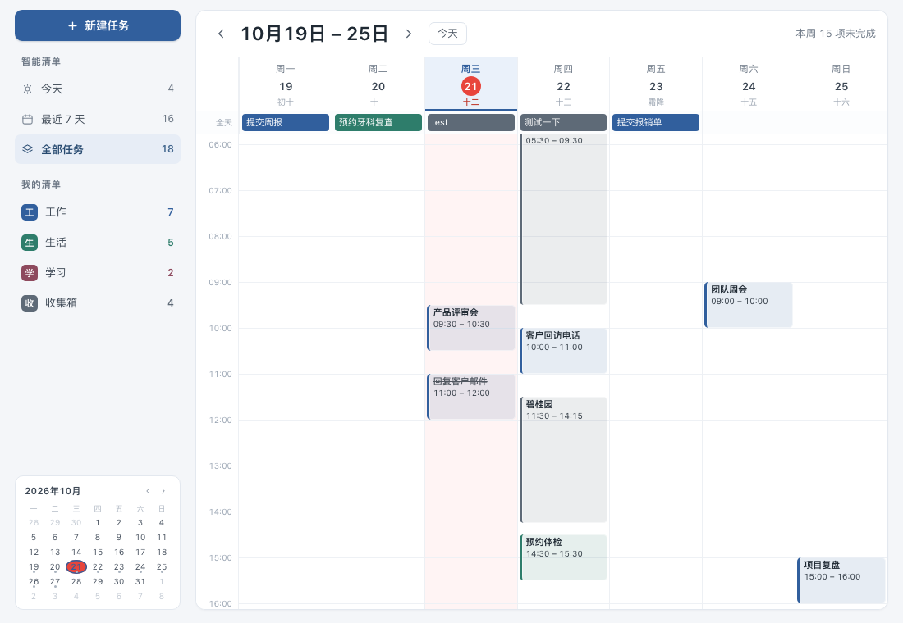
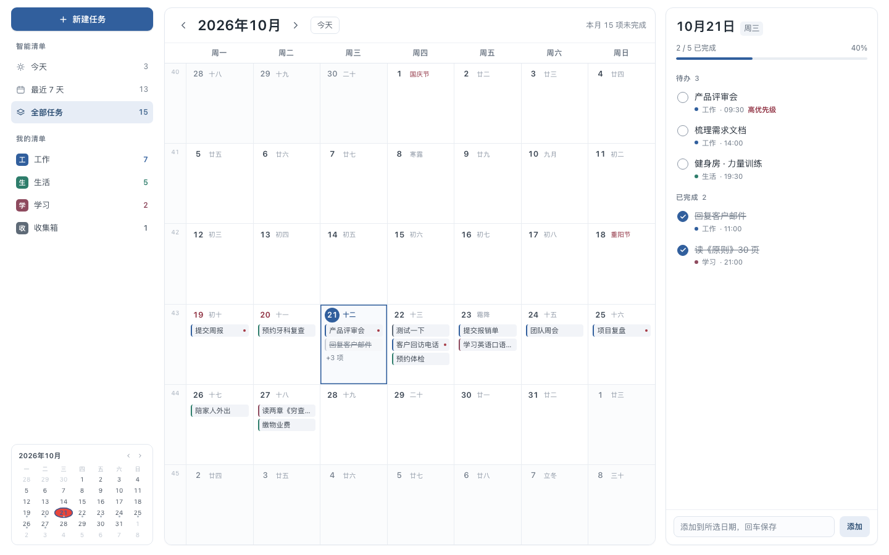
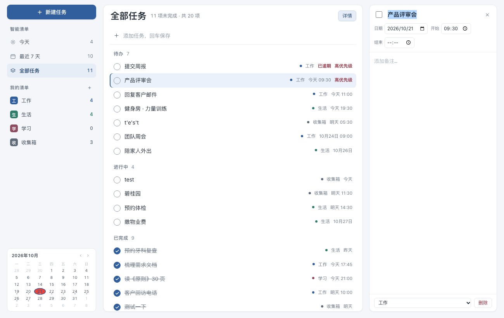
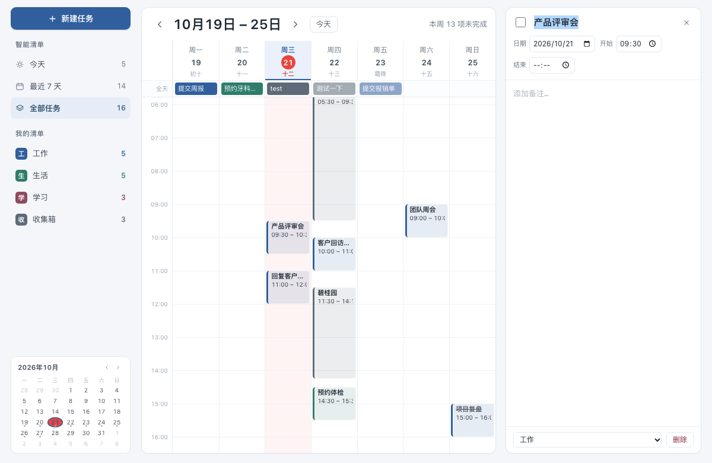

# 日历清单 · DeepSeek Harness 插件

在 [DeepSeek Harness](https://github.com/deepseek-ai) 左侧栏加一个**日历清单**入口，
主区是一个完整的个人任务管理器：月 / 周 / 列表 / 看板四种视图，右侧还带一条独立 AI 对话。

界面参考 macOS 日历与滴答清单。



<details>
<summary>更多截图</summary>

**月视图** — 农历、节气、传统节日



**列表视图** — 左侧清单导航、中间任务、右侧详情



**任务详情** — 标题、日期、时间段、备注



</details>

## 功能

### 四种视图

| 视图 | 特点 |
|---|---|
| **周** | 0:00–24:00 时间轴，每小时 56px，视口约 13 小时，其余滚动；拖选空白创建任务；拖动事件改时间/日期 |
| **月** | 农历、节气、传统节日；周数栏；每天显示任务条；**点某一天直接在格子里输入标题新建任务**（回车保存、Esc 取消） |
| **列表** | 三列结构（清单导航 / 任务列表 / 详情），按状态分组 |
| **看板** | 自定义分组列，拖动卡片切换分组 |

### 任务

- 点任务打开**右侧详情编辑**：标题、完成、日期、开始/结束时间、备注（任意长文本）、清单、删除
- 输入即保存（防抖），失焦后才重绘，打字不闪
- 优先级（普通 / 高）
- 深链 `?task=<id>` 直接打开某条任务

### 清单

- 默认四个：工作 / 生活 / 学习 / 收集箱
- **可增删改**：`+` 新建、双击改名、右键删除（删除时任务自动转移到第一个清单）
- 每个清单有独立颜色

### AI 对话

右侧是一条独立的 DSH 会话，用 `sessions` 服务创建并持久化。
中间的拖动分隔条可调整宽度，双击恢复默认。

## Apple 日历双向同步（0.2.0，macOS）

通过原生 EventKit 桥接，在指定的 iCloud/CalDAV 账户中使用独立的「日历清单」日历。不需要 Apple 账号密码，也不把 DSH 端口暴露到公网。

### 首次启用

此功能需要 macOS 13+、Swift Command Line Tools。在插件目录执行：

```bash
bash scripts/build-calendar-bridge.sh
bash scripts/install-calendar-bridge.sh
```

桥接程序安装到固定的 `~/Library/Application Support/TicklistCalendarBridge/`，避免文稿目录的云同步扩展属性破坏应用签名。构建是本机临时签名，不是经过 Apple 公证的通用发行版；换机器需重新构建，系统也可能要求重新授权。

刷新 DSH，点日历左侧「Apple 日历同步」：

1. 点「授权日历访问」，在 macOS 弹窗亲自允许完整日历访问。
2. 点「刷新状态」，在账户中选择 **iCloud**。若没有账户，先在系统设置中开启 iCloud 日历。
3. 点「启用双向同步」。此时才创建/绑定独立日历并同步，首次启用前自动备份任务。
4. iPhone/iPad 登录同一 Apple 账户，在系统日历里勾选「日历清单」。在手机新建事件时也要选中这个日历。

### 同步范围与安全策略

- 同步标题、日期、起止时间、备注；有日期无时间的任务变成全天事件，无日期任务不导出。
- 完成状态、清单分类、看板分组仍只属于插件，不借删除日程来表示完成。
- 原生日历的全天结束日期为排他边界；跨日任务与事件时区会保留。暂不修改/导入重复事件。
- 每 30 秒尝试一次同步；只在 Mac 开机且 DSH 运行时桥接。Mac 关闭后 Apple 设备之间仍通过 iCloud 同步，DSH 要等 Mac 恢复运行后才能收到修改。
- 首次导入专用日历中过去 1 年至未来 2 年的事件；已关联事件按 ID 跟踪，不把超出查询窗口视为删除。
- 字段级三方合并；两端同时改同一字段时保留两份内容并显示冲突，不静默覆盖。Apple 日历实际写入前再校验旧值。
- 手机删除事件时先保留插件任务并标记冲突，不自动重新创建；在插件删除未冲突的已关联任务会删除相应事件。
- 专用日历里带自定义网址的未关联事件会跳过，避免同步标记覆盖网址。
- 最多跟踪 10000 个关联事件；写入按每批最多 500 个分批处理。
- EventKit 不提供原子条件写入，因此 iCloud 尚未传到本机的修改，以及最终校验和系统提交之间极小的竞态不能完全消除。重要内容仍建议定期备份。

若已有 Mini/SSH 连接配置，保留 Mini 为唯一任务数据源；同步在 **Mini** 上设置，远程客户端不建立本机任务副本。Apple 同步和 SSH 写入共用文件锁与原始文件版本号，旧页面或另一台电脑不会直接覆盖刚同步的数据。

### 验证

```bash
node --test tests/sync-*.test.js
python3 native/test_bridge.py
```

自动测试覆盖双向创建/修改、重试幂等、删除保护、字段冲突、全天/跨日/夏令时、旧页面合并、Mini SSH 兼容和批量写入。真实 iCloud 端到端验收仍需用户完成系统授权后，用专用测试事件验证。

## 安装

需要先装好 DeepSeek Harness（DSH）。

```bash
git clone https://github.com/yzsuki-afk/ticklist-calendar.git
```

然后在 DSH 里对 Agent 说：

> 帮我安装 `/你克隆到的路径/ticklist-calendar` 这个插件

Agent 会调用 `install_bundle` 完成安装，左侧栏随即出现「日历清单」。

> 插件通过绝对路径安装，不需要发布到 npm。

### 安装前自检

仓库带了一个自检脚本，装之前跑一遍能拦住会让 DSH 起不来的错误：

```bash
node scripts/check.js
```

它检查两类问题：

- `client.js` 里 `__ModuleLoader__.load({ id })` 的 id 与 `package.json` 的 `name` 是否一致
- `index.js` / `client.js` 的语法、`cordis.patch.yml` 是否引用了正确的包名

这两项任一不对，装上后 DSH 会直接无法启动。

## ⚠️ 启动失败怎么办

**先说清楚风险**：DSH 的 web boot 要求每个插件 entry 都激活成功，任何插件出错都会让**整个应用起不来**，而弹窗里只有一个「禁用第三方插件」按钮。

那个按钮的代价比文案说的大得多——它会**清空整个 `dsh.profile.bundles`**（实测从 15 个变成 2 个），并把 patch 里的配置项一起丢掉，等于所有第三方插件陪葬。

所以如果 DSH 起不来，**先别点它**，改用仓库自带的急救脚本（在终端里跑，不需要打开 DSH）：

```bash
# 1) 看当前挂了哪些插件，并打印最新崩溃日志
python3 scripts/recover.py status

# 2) 从日志里找到出问题的插件名，只停用它
python3 scripts/recover.py disable ticklist-calendar

# 3) 重启 DSH —— 其他插件全部保留

# 4) 问题修好后恢复
python3 scripts/recover.py enable ticklist-calendar
```

日志里的线索长这样：

```
ticklist-calendar: import failed (see console for the import error)
client-modules: duplicate factory registration for "@local/ticklist-calendar"
```

冒号前面那个名字就是 `disable` 的参数。

脚本做的事就是往 profile 的 `cordis.patch.yml` 追加两行：

```yaml
- id: ticklist-calendar
  disabled: true
```

每次改动前都会自动备份成 `cordis.patch.yml.bak-recover-<时间戳>`。

## 数据存哪

```
~/.dsh/storages/ticklist-calendar/tasks.json
```

一份 JSON，包含 `lists`（清单）、`groups`（看板分组）、`tasks`（任务）三段。
写入用「临时文件 + 原子重命名」，避免写一半断电损坏。
文件损坏时会自动备份成 `tasks.json.corrupt-<时间戳>` 再重置，不会静默吞掉数据。

想备份或迁移，直接复制这个文件即可。

## 技术实现

```
ticklist-calendar/
├── package.json          # bundle 清单 + dsh.client 声明
├── cordis.patch.yml      # 插入一行插件
├── index.js              # Host：页面路由 + GET/PUT /api/state + JSON 文件存储
├── client.js             # Client：左侧栏入口 + 主区（iframe + AI 对话 + 分隔条）
├── app/index.html        # 全部 UI（单文件 HTML/CSS/JS，无构建步骤）
├── locale/{zh,en}.json
├── icon.svg
├── scripts/check.js      # 安装前自检（防 id/包名不一致）
├── scripts/recover.py    # 启动失败急救：精确停用单个插件
└── docs/                 # 截图
```

几个值得记的点：

- **UI 是单个 HTML 文件**，没有打包步骤，改完刷新即生效；Host 只负责静态托管和数据接口。
- **右侧 AI 对话**借助会话作用域的子槽位拿到 `SessionProvider`，再用
  `renderFactorySlot('conversation.content', …)` 渲染原生对话界面。
- **时间轴用固定小时高度**而不是百分比铺满：窗口拉伸时事件块尺寸稳定，
  且不需要监听 resize 重排。
- **窗口拖拽的坑**：`-webkit-app-region: drag` 只在顶层文档生效，
  iframe 内部的元素拖不动窗口。所以顶栏由宿主侧 `client.js` 用 React 渲染，
  iframe 只承载内容区。
- **改包名要同步改客户端模块 id**：`client.js` 顶部的
  `window.__ModuleLoader__.load({ id })` 里的 `id` 必须与 `package.json` 的 `name`
  完全一致。只改其一会导致启动时报
  `duplicate factory registration` / `import failed`，整个 DSH 起不来。

## 已知限制

- 只做了个人使用的核心功能：没有提醒通知、重复任务、标签、子任务、附件
- 清单/分组没有排序拖拽
- 数据是单机 JSON 文件，没有多端同步

## 许可

[MIT](LICENSE)
